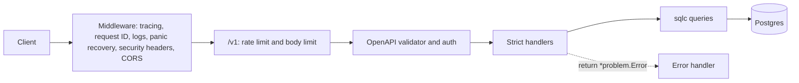

# Architecture

| Layer | Path | Does | Must not |
|---|---|---|---|
| Contract | `api/openapi.yaml` | Defines every route, schema, header, and error | Drift from the code. `make check-generated` fails if it does |
| Entry point | `cmd/api/` | Parses the command, starts the server, handles shutdown | Hold business logic |
| App | `internal/app/` | Middleware, validation, auth, and handlers | Build SQL strings |
| Generated | `internal/api/`, `internal/apiclient/` | Server interface, models, and client from the spec | Be edited by hand |
| Store | `internal/store/` | Typed queries generated by sqlc | Import `net/http` or the app |
| Platform | `internal/problem/`, `auth/`, `publicid/`, `config/` | Errors, hashing, IDs, and configuration | Import the app or the store |
| Database | `internal/database/`, `migrations/` | Pool, migrations, and seed data | Import `net/http` or the app |

`internal/arch_test.go` fails the build when an import breaks these rules.

## Key behaviors

- **Contract:** `oapi-codegen` turns the spec into a strict server interface. A handler that's missing or returns the wrong type won't compile. The kin-openapi validator checks every `/v1` request against the spec before it reaches a handler.
- **Auth:** the validator calls `authenticate` for each operation that declares the `bearer` scheme, and stores the user on the request context. Public operations skip it.
- **Errors:** every failure is RFC 9457 Problem Details. Unexpected errors and panics are logged, with a stack for panics, and recorded on the trace. The client only sees a request ID.
- **Authorization:** every note query filters by the caller's user ID, so another user's note looks like it doesn't exist.
- **Concurrency:** updates need an `If-Match` version, and the check happens inside the `UPDATE` statement.
- **Idempotency:** the key and the note are written in one transaction. A concurrent duplicate waits for the first to commit, then replays it.
- **Database roles:** the API connects as `api_app`, which can read and write rows but can't change the schema. Migrations run as `api_owner`.
