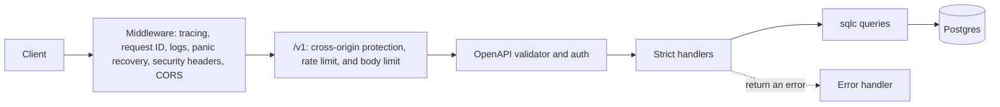

# Architecture

| Layer | Path | Does | Must not |
|---|---|---|---|
| Contract | `api/openapi.yaml` | Defines every route, schema, header, and error | Drift from the code. `make check-generated` fails if it does |
| Entry point | `cmd/api/` | Parses the command, starts the server, handles shutdown | Hold business logic |
| App | `internal/app/` | Middleware, validation, auth, and handlers | Build SQL strings |
| Generated | `internal/api/`, `internal/apiclient/` | Server interface, models, and client from the spec | Be edited by hand |
| Store | `internal/store/` | Typed queries generated by sqlc | Import `net/http` or the app |
| Platform | `internal/problem/`, `auth/`, `publicid/`, `config/` | Errors, hashing, IDs, and configuration | Import the app or the store |
| Database | `internal/database/`, `migrations/` | Pool, migrations, and seed data | Import `net/http` or the app |

`internal/arch_test.go` fails the build when an import breaks these rules.

## Key behaviors

- **Contract:** `oapi-codegen` turns the spec into a strict server interface. A handler that's missing or returns the wrong type won't compile. The kin-openapi validator checks every `/v1` request against the spec before it reaches a handler.
- **Auth:** protected operations accept `bearerAuth` or `cookieAuth`. The validator calls `authenticate` for each scheme in turn, and it stores the user on the request context. A request with an `Authorization` header can only pass `bearerAuth`, so a bad header never falls back to the `__Host-session` cookie. A rejected cookie gets a 401 that clears it. Public operations skip auth.
- **Cross-origin protection:** `http.CrossOriginProtection` checks every `/v1` request that changes data, before rate limits and auth. It allows `Sec-Fetch-Site: same-origin` or `none`, an `Origin` that matches `Host` or is in `CORS_ORIGINS`, and clients that send neither header. Anything else gets 403 `forbidden`, which stops CSRF with a cookie session, including login CSRF.
- **Rate limits:** a global limit per client on every `/v1` request, a stricter one on registration and login, and a failed-login limit per account. Each login counts as a failure before the password check, and a success takes it back, so concurrent guesses can't slip under the limit. A blocked login still hashes a password, so its timing matches. See [ADR 007](decisions/007-key-rate-limits-by-network-and-account.md).
- **Password hashing:** at most `GOMAXPROCS` argon2id hashes run at once, and the rest wait, because each one takes 19 MiB. A burst of logins queues instead of exhausting memory.
- **Errors:** every failure is RFC 9457 Problem Details. A handler returns `*problem.Error` for a client mistake. Any other error, or a panic, is logged with a stack for panics, recorded on the trace, and sent as `internal-error` with only a request ID. When the client has disconnected, the error is logged at debug level with status 499 instead.
- **Authorization:** every note query filters by the caller's user ID, so another user's note looks like it doesn't exist.
- **Concurrency:** updates need an `If-Match` version, and the check happens inside the `UPDATE` statement.
- **Idempotency:** keys are scoped to the user and the endpoint, such as `POST /v1/notes`, so a key reused on another endpoint never replays this one. The key and the note are written in one transaction. A concurrent duplicate waits for the first to commit, then replays it.
- **Cleanup:** every hour, each replica tries a Postgres advisory lock. The one that gets it deletes expired sessions, idempotency keys, and rate limit windows in batches of 1,000, so no statement hits the statement timeout.
- **Database roles:** the API connects as `api_app`, which can read and write rows but can't change the schema. Migrations run as `api_owner`.
